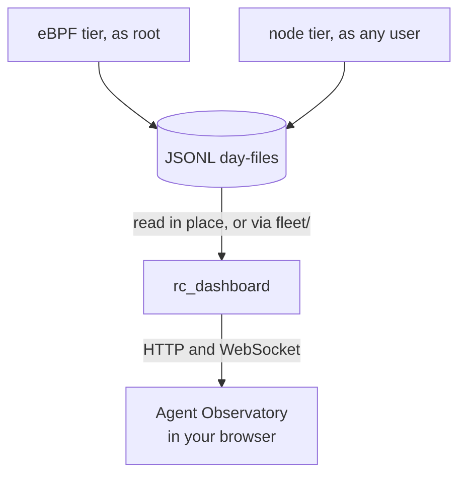

<p align="center">
  <picture>
    <source media="(prefers-color-scheme: dark)" srcset="docs/logo/lockup-dark.svg">
    
  </picture>
</p>

<p align="center">
  <strong>What do AI coding agents actually do on a shared HPC login node?</strong>
</p>

<p align="center">
  <a href="https://madsys.seas.harvard.edu/"></a>
  &nbsp;&nbsp;&nbsp;&nbsp;
  <a href="https://seas.harvard.edu/"></a>
  &nbsp;&nbsp;&nbsp;&nbsp;
  <a href="https://www.rc.fas.harvard.edu/"></a>
</p>

<p align="center">
  <a href="#how-it-works">How it works</a> ·
  <a href="#quick-start">Quick start</a> ·
  <a href="#configuration">Configuration</a> ·
  <a href="#data-and-privacy">Privacy</a> ·
  <a href="#documentation-map">Docs</a> ·
  <a href="#development">Development</a>
</p>

---

This repository measures what coding agents and people do on shared HPC login nodes. A
collector records every process that runs on each node, and a dashboard, **Agent
Observatory**, shows the result live: who ran what, and how much of the node's CPU, memory,
disk, network and scheduler it took. Nothing on the page is estimated or made up; what was
not measured says *not measured*.

## How it works



1. **The collector**, `ebpfm` ([`collector/`](collector/README.md)), runs on each login node
   in two tiers. The **eBPF tier** needs root: it records each process as it exits (its
   command line, CPU, memory, I/O, network, and how it ended), takes a census of what is
   running every 60 seconds, and records each Slurm submission. The **node tier** runs as any
   user: every 5 minutes it reads the node's health from `/proc`, `/sys` and standard tools
   (load, memory, NFS, filesystem space, per-user cgroups), which eBPF cannot see.
2. **The day-files** are all the two halves share. Each tier writes JSONL into one folder per
   day: `<host>.exits.jsonl` and `<host>.snapshot.jsonl` from the eBPF tier, `<host>.jsonl`
   from the node tier. Once a day is over the eBPF tier gzips its files, and they never
   change again. So the dashboard can read a capture made months ago or a whole fleet at
   once, and nothing has to be running for it to start.
3. **The dashboard**, `rc_dashboard` ([`dashboard/`](dashboard/README.md)), reads those
   folders wherever they are: on the node, on a shared mount, or in a copy on the dashboard's
   host. It reduces each record once into its hour, keeps rolling aggregates for whichever
   window you pick, keeps every sealed day as Parquet too for fast selective reads, and
   pushes updates to the page over a WebSocket.

## What it records

Every process is put in one of three classes by the process tree it runs in: **agent**
(Claude Code, OpenAI Codex, GitHub Copilot), **ide** (VS Code, Cursor, Windsurf and other
remote-IDE servers), or **human** (a person at a terminal). Every signal in plain words:
[`collector/WHAT-IT-COLLECTS.md`](collector/WHAT-IT-COLLECTS.md); every record and field:
[`collector/README.md`](collector/README.md#what-it-collects).

## What the dashboard shows

| tab | shows |
|---|---|
| **Live** | what needs attention now; processes exited per minute (per 5 minutes past an hour's window), by class; each class's share of the nodes' CPU, memory, disk and network and of what was asked of Slurm; who is active |
| **Trend** | each class's processes, CPU, users and Slurm submissions per day, week or month over up to a year, from a roll-up table kept as records are ingested |
| **Users** | a portrait of each user from how they use coding agents, and their sessions, each opening its process tree under the portrait |
| **Agents** | every agent and its subagents; where each one's processes ran and wrote (its blast radius); the mix of tools they ran; the commands that failed; then every session, ranked, and an inspector that reads one as tasks, phases and its process tree |
| **Security** | how agents were launched (a bypass flag, auto mode), whether their tool calls ran sandboxed, credentials on their command lines, and where they wrote outside their start folder: each a check of its own, with what it found |
| **Login nodes** | node health, the window's series over time and each login node's responsiveness, and the worst processes (*Resources*); dangerous commands, and credentials on command lines, counted but never shown (*Risks*) |
| **HPC** | the Slurm scheduler: abnormal use first (polling the queue fast, bursts of checks or submissions, refusals, cancels and failed runs again and again, each a rule with a threshold the site sets), then each session's and each class's use of it, its refusals and the latest submissions |
| **Ask LLM** | questions about the window on screen, answered by an agent that cites the panels it read; off unless a site turns it on |
| **Feeds** | each collector and feed: where it was looked for, its status, how fresh it is; and every resolved setting |

The whole page can be narrowed to classes, users and agent types, over any window the
service offers. What each tab holds: [`dashboard/web/README.md`](dashboard/web/README.md#tabs);
what each figure computes, from which records, at what cost:
[`docs/figures/README.md`](docs/figures/README.md).

## Quick start

You need [uv](https://docs.astral.sh/uv/), which fetches Python 3.11 or later if it is
missing, and Node.js with npm to build the page.

### Try it without a cluster

```bash
cd dashboard
uv sync --frozen
(cd web && npm ci && npm run build)
uv run --frozen python -m rc_dashboard demo     # then open http://127.0.0.1:8080
```

The demo runs the real service over a synthetic feed it writes itself, for fictional login
nodes and users, and keeps appending to it; every page says *fake data*. It also runs at
<https://dashboard-demo.agentic-system.org>, behind a password of its own
([`deploy/cloudflare`](deploy/cloudflare/README.md)), and as an image
([`docker/demo`](docker/README.md#the-demo)).

### Collect on a login node

From the source tree, as root, for both tiers:

```bash
sudo ./collector/ebpfm.sh bootstrap    # once per node: dependencies and two kernel settings
sudo ./collector/ebpfm.sh check        # one line per precondition; expect 0 FAIL
sudo ./collector/ebpfm.sh start        # both tiers
sudo ./collector/ebpfm.sh status       # each stream's records and size today
sudo ./collector/ebpfm.sh stop         # processes still running are written as `truncated`
```

- Without `sudo`, `start` runs the node tier alone: half of the data, not a degraded mode.
- `start` lasts until a reboot. To keep the collector running, install its units
  (`sudo ./collector/ebpfm.sh install-unit`, then `sudo systemctl enable --now ebpfm ebpfm-node`),
  the [RPM](packaging/rpm/README.md) for Rocky/RHEL 8, or the
  [container image](docker/README.md#the-collector).
- The `collector/` folder is self-contained: copy it to the node, or hand over the single
  file `./collector/ebpfm.sh bundle` writes.

As root it writes to `/scratch/ebpfm` and `/scratch/ebpfm-login` where `/scratch` is
writable, else to `/var/log/ebpfm` and `/var/log/ebpfm-login`; as a user, to
`~/.ebpfm/login`. `EBPFM_OUTPUT_DIR` and `EBPFM_NODE_OUTPUT_DIR` override them; the RPM's unit
writes to `/scratch/ebpfm`.

### Run the dashboard over real data

```bash
cd dashboard
uv sync --frozen
(cd web && npm ci && npm run build)                   # builds the page into web/dist/
uv run --frozen python -m rc_dashboard new-password   # once: writes a password, prints its hash
```

Put the hash in `dashboard/dashboard.config.json` (gitignored) as
`{"server": {"auth": {"password_hash": "<hash>"}}}`, then point the service at the
collector's folders and start it:

```bash
export RC_DASH_EBPF_ROOTS=/scratch/ebpfm RC_DASH_NODE_ROOTS=/scratch/ebpfm-login   # the defaults skip /scratch
uv run --frozen python -m rc_dashboard --check-feeds  # what it found, and everywhere it looked
uv run --frozen python -m rc_dashboard serve          # on 127.0.0.1:8080 (RC_DASH_HOST, RC_DASH_PORT)
```

From another machine, open it through a tunnel: `ssh -L 8080:127.0.0.1:8080 <host>`. `serve`
refuses to start without a password, since on a login node every user can reach 127.0.0.1
([Password](dashboard/README.md#password)).

### Run it live

Three layouts, the same collector and dashboard in each, the dashboard behind a password on
127.0.0.1:

| Layout | What runs where | Guide |
|---|---|---|
| **One server** | the server runs the collector and the dashboard, as systemd units | [`deploy/single`](deploy/single/README.md) |
| **A fleet** | every node runs the collector; one more host runs the dashboard over a copy of their files, pulled with rsync every minute | [`deploy/fleet`](deploy/fleet/README.md) |
| **A cluster's login nodes** | the same where you have no root anywhere: each node's files stream over ssh to a host of your own ([`hpc/fleet/`](hpc/fleet/README.md)), set from one file and checked every hour | [`hpc/deploy`](hpc/deploy/README.md) |

[`deploy/README.md`](deploy/README.md) covers what the first two share: the units, the
password, watching and upgrading. [`hpc/README.md`](hpc/README.md) says what is HPC-specific.

## Configuration

Each setting resolves on its own: a command-line flag wins over an `RC_DASH_*` environment
variable, which wins over `dashboard/dashboard.config.json`, which wins over the default.
[`dashboard.config.example.json`](dashboard/dashboard.config.example.json) describes every
key, and `--print-config` prints each resolved setting and where it came from. How they
resolve, and what each does: [`dashboard/README.md`](dashboard/README.md#configuration).

## Data and privacy

The records name real users and show what they ran, so both halves keep them close.

- **On each node**, the collector creates its folders `0750` and its files `0640`
  (`EBPFM_DIR_MODE`, `EBPFM_FILE_MODE`; `EBPFM_GROUP` opens them to one group), and masks
  every command line before writing it: credentials (API keys, tokens, passwords, private
  keys) become `[REDACTED]`, and the prompts handed to an agent on its command line
  `[REDACTED-PROMPT]` (`EBPFM_REDACT`). Its records go only to its output folders; its one use of the network is
  resolving host names that command lines mention, to name the endpoints a process talked to
  (`EBPFM_ARGV_HOSTS=0` turns that off).
- **The dashboard** will not start without a password unless told to (`--open`), and masks
  credentials again on every way out. `RC_DASH_ANONYMIZE=1` replaces every name with an alias.
  It names network endpoints by reverse DNS from its own host (`RC_DASH_RDNS=0` turns that
  off). **Ask LLM**, off by default, sends masked data to a model's provider when a site turns
  it on.
- **The fleet stream** carries the files over ssh, with a key that can run the sender and
  nothing else, and only from the dashboard's host.
- **The fleet's copy** ([`deploy/fleet`](deploy/fleet/README.md)) is pulled by an account in
  the collector's group, with a key that runs read-only rsync of the collector's folders and
  nothing else (`rrsync -ro`, where the node has it), only from the dashboard's host, into a
  folder only the dashboard's account can read.

## Documentation map

| document | read it for |
|---|---|
| [`collector/README.md`](collector/README.md) | the two tiers; why eBPF; measured overhead; every record and field; the `ebpfm.sh` commands and settings; kernel support |
| [`collector/WHAT-IT-COLLECTS.md`](collector/WHAT-IT-COLLECTS.md) | every signal the collector records, in plain words |
| [`collector/COVERAGE.md`](collector/COVERAGE.md) | which tier reads each observable login-node signal |
| [`collector/VENDORED.md`](collector/VENDORED.md) | the modules copied from elsewhere, and the rule that keeps them in step |
| [`packaging/rpm/README.md`](packaging/rpm/README.md) | the RPM: getting it, installing it, what it lays down, its dependencies and kernel settings |
| [`docker/README.md`](docker/README.md) | the three images and their tags; running the collector in a container; the demo image |
| [`dashboard/README.md`](dashboard/README.md) | running the service: how feeds are found and settings resolved; the history store; windows and the hourly merge-reduce; the REST and WebSocket API; sign-in; how every tab computes what it shows; the module layout |
| [`dashboard/web/README.md`](dashboard/web/README.md) | the page: its tabs, charts, filters and URL state, the dev fixture, and the integrity rules the code enforces |
| [`dashboard/risk-profiles/README.md`](dashboard/risk-profiles/README.md) | what counts as risky on a given cluster, and how to write and check a profile |
| [`dashboard/bench/README.md`](dashboard/bench/README.md) | a synthetic feed at fleet scale, timers, a profiler, and a check that a change kept every answer the same |
| [`docs/figures/README.md`](docs/figures/README.md) | every figure on the page: what it computes, from which records, by which read path, at what cost |
| [`docs/feed-parquet/README.md`](docs/feed-parquet/README.md) | the feed as typed Parquet tables: the dashboard's history store, and a dataset for analysis |
| [`docs/feed-format-v9/README.md`](docs/feed-format-v9/README.md) | a proposed feed schema 9, not implemented, with a prototype that measures it |
| [`docs/plans/`](docs/plans/) | implementation plans, kept as the record of how the work was done |
| [`deploy/README.md`](deploy/README.md) | the live service on servers where you have root: what runs where, the password, watching, settings, upgrading; [`single/`](deploy/single/README.md) and [`fleet/`](deploy/fleet/README.md) install each layout |
| [`hpc/README.md`](hpc/README.md) | what is HPC-specific, and which HPC settings stay in the collector and the dashboard |
| [`hpc/fleet/README.md`](hpc/fleet/README.md) | the fleet stream's three programs, and what each is for |
| [`hpc/deploy/README.md`](hpc/deploy/README.md) | the live deployment on login nodes: the settings file, the first deploy, memory and disk, upgrades, and the hourly check |
| [`deploy/cloudflare/README.md`](deploy/cloudflare/README.md) | the public demo: deploying it, its password, and deploying from GitHub |
| [`docs/logo/README.md`](docs/logo/README.md) | the mark and the lockups |
| [`CLAUDE.md`](CLAUDE.md) | for Claude Code sessions, and a short guide for anyone: where pull requests go and what a push sets off, the commands and test suites, and the constraints that bite |

Paths such as `collect/`, `analyze/` and `findings/` in the collector's and dashboard's
documents name the larger measurement repository they were first written in; nothing here
depends on them.

## Development

Pull requests go to `develop`, never `main`. Commit style, what a push or tag sets off, and
the test suites as CI runs them: [`CLAUDE.md`](CLAUDE.md).

## The rules both halves obey

These are research-integrity constraints, not preferences; each one is a mistake this project
made once.

- **Null is not zero, and zero is not missing.** A measurement the collector could not take is
  `null`, never `0`, and the page says *not measured*. A nullable field carries its coverage
  and is never imputed. A feed that is present but has no matching rows says `none`; an absent
  feed names the path it expected.
- **Three actor classes, never two:** `agent`, `human` and `ide`. Editors a person drives
  (VS Code, Cursor, Windsurf) are `ide`, not `agent`: folding them into the agents once
  produced a claim about GPU use that had to be retracted.
- **Nothing is fabricated.** The collector writes only what it measured. The page never calls
  `Math.random()` (`npm run check:no-random` enforces it) and never draws a line across a
  minute with no record: that minute is a gap.
- **`sandbox` and `approval` are independent**, and `denied`, the collector being unable to
  read the field, is a state of its own, never counted as `unsandboxed`.
- **Scope is stated.** The collector runs on login nodes, so its figures are login-node use,
  not cluster use.

## Requirements

- **Collector:** Linux and Python 3.6 or later. The eBPF tier needs BCC (`python3-bpfcc` on
  Ubuntu, `python3-bcc` on RHEL and Rocky) and kernel headers, which `bootstrap` installs; it
  was developed on kernels 6.8 and 6.17, with fallbacks for EL8's 4.18. The node tier needs
  only `/proc`, `/sys` and standard tools (procps-ng, sysstat, nfs-utils, iproute); a missing
  tool blanks only its own section. The RPM pulls in everything.
- **Dashboard:** Python 3.11 or later with what [`dashboard/pyproject.toml`](dashboard/pyproject.toml)
  lists, installed by `uv`; Node.js and npm to build the page.
