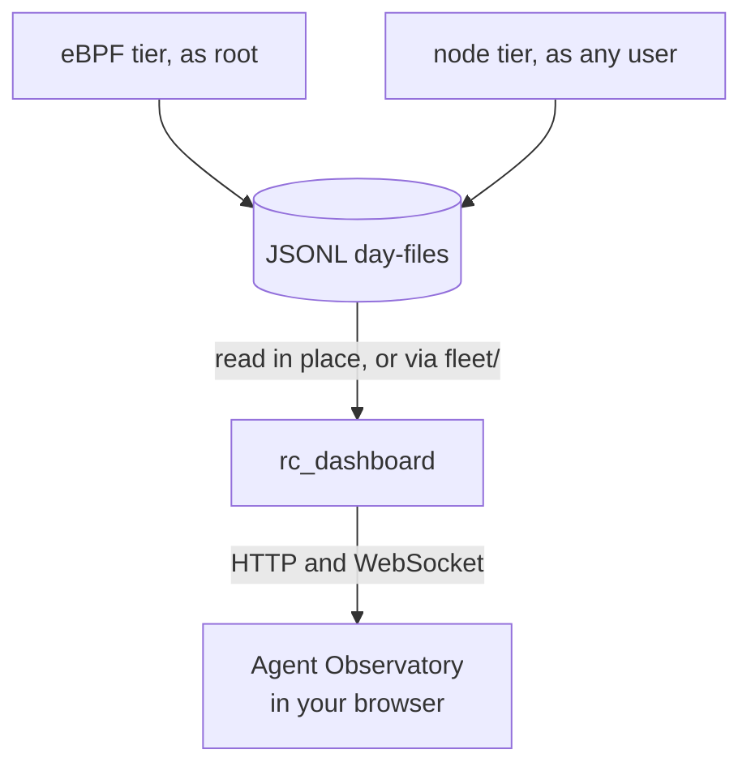

<p align="center">
  <picture>
    <source media="(prefers-color-scheme: dark)" srcset="docs/logo/lockup-dark.svg">
    
  </picture>
</p>

<p align="center">
  <strong>What do AI coding agents actually do on a shared HPC login node?</strong>
</p>

<p align="center">
  <a href="https://madsys.seas.harvard.edu/"></a>
  &nbsp;&nbsp;&nbsp;&nbsp;
  <a href="https://seas.harvard.edu/"></a>
  &nbsp;&nbsp;&nbsp;&nbsp;
  <a href="https://www.rc.fas.harvard.edu/"></a>
</p>

<p align="center">
  <a href="#how-it-works">How it works</a> ·
  <a href="#quick-start">Quick start</a> ·
  <a href="#configuration">Configuration</a> ·
  <a href="#data-and-privacy">Privacy</a> ·
  <a href="#documentation-map">Docs</a> ·
  <a href="#development">Development</a>
</p>

---

This repository measures what coding agents and people do on shared HPC login nodes. A
collector records every process that runs on each node, and a dashboard, **Agent
Observatory**, shows the result live: who ran what, and how much of the node's CPU, memory,
disk, network and scheduler it took. Nothing on the page is estimated or made up; what was
not measured says *not measured*.

## How it works



1. **The collector**, `ebpfm` ([`collector/`](collector/README.md)), runs on each login node
   in two tiers. The **eBPF tier** needs root: it records each process as it exits (its
   command line, CPU, memory, I/O, network, and how it ended), takes a census of what is
   running every 60 seconds, and records each Slurm submission. The **node tier** runs as any
   user: every 5 minutes it reads the node's health from `/proc`, `/sys` and standard tools
   (load, memory, NFS, filesystem space, per-user cgroups), which eBPF cannot see.
2. **The day-files** are all the two halves share. Each tier writes JSONL into one folder per
   day: `<host>.exits.jsonl` and `<host>.snapshot.jsonl` from the eBPF tier, `<host>.jsonl`
   from the node tier. Once a day is over the eBPF tier gzips its files, and they never
   change again. So the dashboard can read a capture made months ago or a whole fleet at
   once, and nothing has to be running for it to start.
3. **The dashboard**, `rc_dashboard` ([`dashboard/`](dashboard/README.md)), reads those
   folders wherever they are: on the node, on a shared mount, or in a copy on the dashboard's
   host. It reduces each record once into its hour, keeps rolling aggregates for whichever
   window you pick, keeps every sealed day as Parquet too for fast selective reads, and
   pushes updates to the page over a WebSocket.

## What it records

Every process is put in one of three classes by the process tree it runs in: **agent**
(Claude Code, OpenAI Codex, GitHub Copilot), **ide** (VS Code, Cursor, Windsurf and other
remote-IDE servers), or **human** (a person at a terminal). Every signal in plain words:
[`collector/WHAT-IT-COLLECTS.md`](collector/WHAT-IT-COLLECTS.md); every record and field:
[`collector/README.md`](collector/README.md#what-it-collects).

## What the dashboard shows

Six stops in the rail, each answering one question; an entry with more than one tab holds them
as sub-tabs.

| stop | shows |
|---|---|
| **Live** | what needs attention now; processes exited per minute (per 5 minutes past an hour's window), by class; each class's share of the nodes' CPU, memory, disk and network and of what was asked of Slurm; who is active |
| **Users** | a portrait of each user from how they use coding agents, and their sessions, each opening its process tree under the portrait |
| **Agents** › Agents · Sessions | every agent and its subagents, where each one's processes ran and wrote (its blast radius), the mix of tools they ran and the commands that failed; then every session, ranked, and an inspector that reads one as tasks, phases and its process tree |
| **Risk** › Security · Site rules | how agents were launched (a bypass flag, auto mode), whether their tool calls ran sandboxed, credentials on their command lines, and where they wrote outside their start folder, each a check of its own; and what the site's rules say should not run on a login node, credentials counted but never shown |
| **Usage** › Login nodes · HPC · Trend | node health, the window's series and each login node's responsiveness, the worst processes; the Slurm scheduler, abnormal use first, each rule a threshold the site sets; each class's use per day, week or month over up to a year |
| **System** › Feeds | each collector and feed: where it was looked for, its status, how fresh it is, and the version of each; every resolved setting |

**Ask LLM** opens beside any tab, from the head's Ask button, where a site turns it on:
questions about the window on screen, answered by an agent that cites the panels it read. With
no data at all, the tabs give way to a setup screen that says where the dashboard looked and
how to fix it; Trend stays, since its roll-up table outlives the day-files it was made from. Ctrl+K (or `/`) goes to any tab, section, user, login node or session.

The whole page can be narrowed to classes, users and agent types, over any window the
service offers. What each tab holds: [`dashboard/web/README.md`](dashboard/web/README.md#tabs);
what each figure computes, from which records, at what cost:
[`docs/figures/README.md`](docs/figures/README.md).

## Quick start

You need [uv](https://docs.astral.sh/uv/), which fetches Python 3.11 or later if it is
missing, and Node.js with npm to build the page.

### Try it without a cluster

```bash
cd dashboard
uv sync --frozen
(cd web && npm ci && npm run build)
uv run --frozen rc-dashboard demo     # then open http://127.0.0.1:8080
```

The demo runs the real service over a synthetic feed it writes itself, for fictional login
nodes and users, and keeps appending to it; every page says *fake data*. It also runs at
<https://dashboard-demo.agentic-system.org>, behind a password of its own
([`deploy/cloudflare`](deploy/cloudflare/README.md)), and as an image
([`docker/demo`](docker/README.md#the-demo)).

### Collect on a login node

From the source tree, as root, both tiers in one step:

```bash
sudo ./collector/ebpfm.sh install --dry-run   # the plan; changes nothing
sudo ./collector/ebpfm.sh install             # dependencies, /etc/default/ebpfm, both units started, check, verdict
sudo ./collector/ebpfm.sh status              # each tier: running, and writing? exit 0 healthy, 1 degraded or stale, 3 not running
```

- `install` ends with `READY: both tiers`, `READY: node tier only` or `NOT READY: N FAIL`,
  each FAIL with its fix; run it again once fixed, or after an upgrade. The units start both
  tiers at every boot.
- Without root, `./collector/ebpfm.sh start` runs the node tier alone, until a reboot: half of
  the data, not a degraded mode. `start`, `stop` and `status` drive the tiers without units too.
- `./collector/ebpfm.sh help` lists every command and `<command> --help` explains one;
  `./collector/ebpfm.sh config` shows each setting and where it came from: the environment,
  then `/etc/default/ebpfm`, then the default.
- The [RPM](packaging/rpm/README.md) for Rocky/RHEL 8 and the
  [container image](docker/README.md#the-collector) run the eBPF tier.
- The `collector/` folder is self-contained: copy it to the node, or hand over the single file
  `./collector/ebpfm.sh bundle` writes (`./ebpfm-bundle.sh --extract /opt/ebpfm` unpacks it
  for `install`).

As root it writes to `/scratch/ebpfm` and `/scratch/ebpfm-login` where `/scratch` is
writable, else to `/var/log/ebpfm` and `/var/log/ebpfm-login`; as a user, to
`~/.ebpfm/login`. `install` records the choice in `/etc/default/ebpfm`, and
`EBPFM_OUTPUT_DIR` and `EBPFM_NODE_OUTPUT_DIR` override it; the RPM's unit writes to
`/scratch/ebpfm`. Running it day to day, upgrading and removing it:
[`collector/OPERATIONS.md`](collector/OPERATIONS.md).

### Run the dashboard over real data

```bash
cd dashboard
uv sync --frozen
(cd web && npm ci && npm run build)    # builds the page into web/dist/
uv run --frozen rc-dashboard init      # finds the collector's folders, makes a password, writes dashboard.toml
uv run --frozen rc-dashboard serve     # on 127.0.0.1:8080: the command init printed
```

`init` asks for each value, showing what it found (`--yes` takes them all; `rc-dashboard init
--help`). It writes a short `dashboard/dashboard.toml`, keeps the password in
`~/.config/rc-dashboard/password` with its hash in `password.hash` beside it, checks the feeds,
and prints the `ssh -L` command to reach the page from another machine.
`rc-dashboard check-feeds` lists every place it looked and what it found there. `serve` refuses
to start without a password, since on a login node every user can reach 127.0.0.1
([Password](dashboard/README.md#password)). `rc-dashboard status` says per node whether its
collector and its copy work (exit 0, 1 or 2, for a monitor). The page also comes as a wheel
and an image with the page built in, needing no Node ([`docker`](docker/README.md#the-dashboard)).

### Run it live

Three layouts, the same collector and dashboard in each, the dashboard behind a password on
127.0.0.1:

One front door picks the layout from four questions (Slurm? which nodes? root on the nodes?
root on the dashboard's host?) and runs its scripts:

```bash
deploy/rc-deploy init           # writes the settings file, and records the layout in it
sudo deploy/rc-deploy plan      # what it would do; nothing done (hpc runs as you, no sudo)
sudo deploy/rc-deploy apply
sudo deploy/rc-deploy password  # makes the password; its hash goes where the dashboard reads it
deploy/rc-deploy status         # every collector's verdict and every node's copy
```

| Layout | What runs where | Guide |
|---|---|---|
| **One server** | the server runs the collector and the dashboard, as systemd units | [`deploy/single`](deploy/single/README.md) |
| **A fleet** | every node runs the collector; one more host runs the dashboard over a copy of their files, pulled with rsync every minute | [`deploy/fleet`](deploy/fleet/README.md) |
| **A cluster's login nodes** | the same where you have no root anywhere: a host of your own copies each node's files with the same rsync, through a key the nodes let run nothing else ([`hpc/fleet/`](hpc/fleet/README.md)), set from one file and checked every hour | [`hpc/deploy`](hpc/deploy/README.md) |

[`deploy/README.md`](deploy/README.md) covers what the first two share: the units, the
password, the hourly check, settings, upgrading, backups, moving and removing.
[`hpc/README.md`](hpc/README.md) says what is HPC-specific. `rc-deploy --help` lists the rest.

## Configuration

Each setting resolves on its own: a command-line flag wins over an `RC_DASH_*` environment
variable, which wins over the config file (`dashboard/dashboard.toml` or
`dashboard/dashboard.config.json`, TOML or JSON), which wins over the default.
[`dashboard.example.toml`](dashboard/dashboard.example.toml) is a dozen lines to start from.
`rc-dashboard print-config --reference` prints every setting with its default, and
`rc-dashboard print-config` prints each resolved setting and where it came from. How they
resolve, and what each does: [`dashboard/README.md`](dashboard/README.md#configuration).

The deployment kits take the same names for the same settings: `SITE_NAME`, `SITE_DESCRIPTION`,
`SLURM`, `NODE_NOUN`, `ANONYMIZE` (1/0, true/false, yes/no, on/off), `MEMORY_MAX` and
`FREE_MIN_GB`. They go in `deploy/site.env` (rc-deploy), the deploy/ installers' environment,
or `hpc/deploy/site.env`; each sets the dashboard's own setting (`deploy/README.md`,
"Settings"). The collector reads `/etc/default/ebpfm` (`ebpfm config` shows every setting).

## Data and privacy

The records name real users and show what they ran, so both halves keep them close.

- **On each node**, the collector creates its folders `0750` and its files `0640`
  (`EBPFM_DIR_MODE`, `EBPFM_FILE_MODE`; `EBPFM_GROUP` opens them to one group), and masks
  every command line before writing it: credentials (API keys, tokens, passwords, private
  keys) become `[REDACTED]`, and the prompts handed to an agent on its command line
  `[REDACTED-PROMPT]` (`EBPFM_REDACT`). Its records go only to its output folders; its one use of the network is
  resolving host names that command lines mention, to name the endpoints a process talked to
  (`EBPFM_ARGV_HOSTS=0` turns that off).
- **The dashboard** will not start without a password unless told to (`--open`), and masks
  credentials again on every way out. `RC_DASH_ANONYMIZE=1` replaces every name with an alias.
  It names network endpoints by reverse DNS from its own host (`RC_DASH_RDNS=0` turns that
  off). **Ask LLM**, off by default, sends masked data to a model's provider when a site turns
  it on.
- **The copy** of the nodes' files is pulled with a key that runs read-only rsync of the
  collector's folders and nothing else, only from the dashboard's host, into a folder only
  the dashboard's account can read: by an account in the collector's group, through `rrsync
  -ro` where the node has it ([`deploy/fleet`](deploy/fleet/README.md)), or, with no root on
  the nodes, through [`hpc/fleet`](hpc/fleet/README.md)'s guard.

## Documentation map

| document | read it for |
|---|---|
| [`docs/troubleshooting.md`](docs/troubleshooting.md) | something is wrong: no data, a node stopped reporting, sign-in fails, the page is blank; each symptom's causes and the command that tells them apart |
| [`collector/OPERATIONS.md`](collector/OPERATIONS.md) | installing, checking, running and watching the collector; every setting; upgrading, removing, troubleshooting |
| [`collector/README.md`](collector/README.md) | the two tiers; why eBPF; measured overhead; every record and field; the `ebpfm.sh` commands and settings; kernel support |
| [`collector/WHAT-IT-COLLECTS.md`](collector/WHAT-IT-COLLECTS.md) | every signal the collector records, in plain words |
| [`collector/COVERAGE.md`](collector/COVERAGE.md) | which tier reads each observable login-node signal |
| [`collector/VENDORED.md`](collector/VENDORED.md) | the modules copied from elsewhere, and the rule that keeps them in step |
| [`packaging/rpm/README.md`](packaging/rpm/README.md) | the RPM: getting it, installing it, what it lays down, its dependencies and kernel settings |
| [`docker/README.md`](docker/README.md) | the three images and their tags; running the collector in a container; the demo image |
| [`dashboard/README.md`](dashboard/README.md) | running the service: how feeds are found and settings resolved; the history store; windows and the hourly merge-reduce; the REST and WebSocket API; sign-in; how every tab computes what it shows; the module layout |
| [`dashboard/web/README.md`](dashboard/web/README.md) | the page: its tabs, charts, filters and URL state, the dev fixture, and the integrity rules the code enforces |
| [`dashboard/risk-profiles/README.md`](dashboard/risk-profiles/README.md) | what counts as risky on a given cluster, and how to write and check a profile |
| [`dashboard/bench/README.md`](dashboard/bench/README.md) | a synthetic feed at fleet scale, timers, a profiler, and a check that a change kept every answer the same |
| [`docs/figures/README.md`](docs/figures/README.md) | every figure on the page: what it computes, from which records, by which read path, at what cost |
| [`docs/feed-parquet/README.md`](docs/feed-parquet/README.md) | the feed as typed Parquet tables: the dashboard's history store, and a dataset for analysis |
| [`docs/feed-format-v9/README.md`](docs/feed-format-v9/README.md) | a proposed feed schema 9, not implemented, with a prototype that measures it |
| [`docs/plans/`](docs/plans/) | implementation plans, kept as the record of how the work was done |
| [`deploy/README.md`](deploy/README.md) | the live service on servers where you have root: what runs where, the password, watching, settings, upgrading; [`single/`](deploy/single/README.md) and [`fleet/`](deploy/fleet/README.md) install each layout |
| [`hpc/README.md`](hpc/README.md) | what is HPC-specific, and which HPC settings stay in the collector and the dashboard |
| [`hpc/fleet/README.md`](hpc/fleet/README.md) | the guard that lets the copy's key read the collector's folder and nothing else |
| [`hpc/deploy/README.md`](hpc/deploy/README.md) | the live deployment on login nodes: the settings file, the first deploy, memory and disk, upgrades, and the hourly check |
| [`deploy/cloudflare/README.md`](deploy/cloudflare/README.md) | the public demo: deploying it, its password, and deploying from GitHub |
| [`docs/logo/README.md`](docs/logo/README.md) | the mark and the lockups |
| [`CLAUDE.md`](CLAUDE.md) | for Claude Code sessions, and a short guide for anyone: where pull requests go and what a push sets off, the commands and test suites, and the constraints that bite |

Paths such as `collect/`, `analyze/` and `findings/` in the collector's and dashboard's
documents name the larger measurement repository they were first written in; nothing here
depends on them.

## Development

Pull requests go to `develop`, never `main`. Commit style, what a push or tag sets off, and
the test suites as CI runs them: [`CLAUDE.md`](CLAUDE.md).

## The rules both halves obey

These are research-integrity constraints, not preferences; each one is a mistake this project
made once.

- **Null is not zero, and zero is not missing.** A measurement the collector could not take is
  `null`, never `0`, and the page says *not measured*. A nullable field carries its coverage
  and is never imputed. A feed that is present but has no matching rows says `none`; an absent
  feed names the path it expected.
- **Three actor classes, never two:** `agent`, `human` and `ide`. Editors a person drives
  (VS Code, Cursor, Windsurf) are `ide`, not `agent`: folding them into the agents once
  produced a claim about GPU use that had to be retracted.
- **Nothing is fabricated.** The collector writes only what it measured. The page never calls
  `Math.random()` (`npm run check:no-random` enforces it) and never draws a line across a
  minute with no record: that minute is a gap.
- **`sandbox` and `approval` are independent**, and `denied`, the collector being unable to
  read the field, is a state of its own, never counted as `unsandboxed`.
- **Scope is stated.** The collector runs on login nodes, so its figures are login-node use,
  not cluster use.

## Requirements

- **Collector:** Linux and Python 3.6 or later. The eBPF tier needs BCC (`python3-bpfcc` on
  Ubuntu, `python3-bcc` on RHEL and Rocky) and kernel headers, which `bootstrap` installs; it
  was developed on kernels 6.8 and 6.17, with fallbacks for EL8's 4.18. The node tier needs
  only `/proc`, `/sys` and standard tools (procps-ng, sysstat, nfs-utils, iproute); a missing
  tool blanks only its own section. The RPM pulls in everything.
- **Dashboard:** Python 3.11 or later with what [`dashboard/pyproject.toml`](dashboard/pyproject.toml)
  lists, installed by `uv`; Node.js and npm to build the page.
