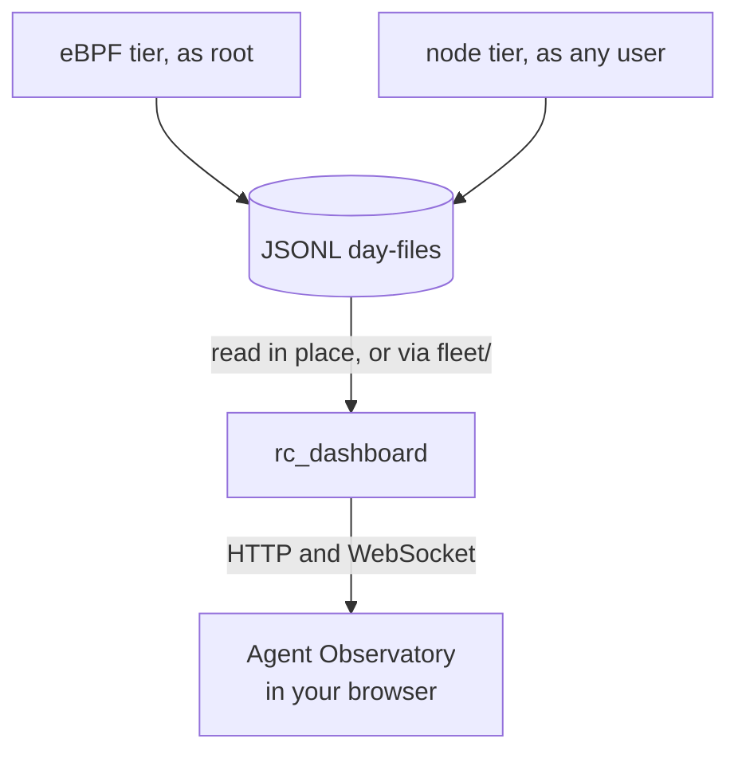

<p align="center">
  <picture>
    <source media="(prefers-color-scheme: dark)" srcset="docs/logo/lockup-dark.svg">
    
  </picture>
</p>

<p align="center">
  <strong>What do AI coding agents actually do on a shared HPC login node?</strong>
</p>

<p align="center">
  <a href="https://madsys.seas.harvard.edu/"></a>
  &nbsp;&nbsp;&nbsp;&nbsp;
  <a href="https://seas.harvard.edu/"></a>
  &nbsp;&nbsp;&nbsp;&nbsp;
  <a href="https://www.rc.fas.harvard.edu/"></a>
</p>

<p align="center">
  <a href="#how-it-works">How it works</a> ·
  <a href="#quick-start">Quick start</a> ·
  <a href="#configuration">Configuration</a> ·
  <a href="#data-and-privacy">Privacy</a> ·
  <a href="#documentation-map">Docs</a> ·
  <a href="#development">Development</a>
</p>

---

This repository measures what coding agents and people do on shared HPC login nodes. A
collector records every process that runs on each node, and a dashboard, **Agent
Observatory**, shows the result live: who ran what, and how much of the node's CPU, memory,
disk, network and scheduler it took. Nothing on the page is estimated or made up; what was
not measured says *not measured*.

## How it works



1. **The collector**, `ebpfm` ([`collector/`](collector/README.md)), runs on each login node
   in two tiers. The **eBPF tier** needs root: it hooks the kernel and records each process
   as it exits (its command line, CPU, memory, I/O, network, and how it ended), takes a
   census of what is running every 60 seconds, and records each Slurm submission. The
   **node tier** runs as any user: every 5 minutes it reads the node's health from `/proc`,
   `/sys` and standard tools (load, memory, NFS, filesystem space, per-user cgroups), which
   eBPF cannot see at all.
2. **The day-files** are the only thing the two halves share. Each tier writes JSONL into one
   folder per day: `<host>.exits.jsonl` and `<host>.snapshot.jsonl` from the eBPF tier,
   `<host>.jsonl` from the node tier. Once a day is over the collector gzips its files, and
   they never change again. Because the halves meet only on disk (record schema 8), the
   dashboard can read a capture made months ago or a whole fleet at once, and nothing has to
   be running for it to start.
3. **The dashboard**, `rc_dashboard` ([`dashboard/`](dashboard/README.md)), reads those
   folders wherever they are: on the node itself, on a shared mount, or in the copy the
   [fleet stream](hpc/fleet/README.md) keeps on the dashboard's host. It reduces each record once
   into its hour, keeps rolling aggregates for whichever window you pick, keeps every sealed
   day as Parquet too for fast selective reads, and pushes updates to the page over a
   WebSocket.

## What it records

Every process is put in one of three classes by the process tree it runs in: **agent**
(Claude Code, OpenAI Codex, GitHub Copilot), **ide** (VS Code, Cursor, Windsurf and other
remote-IDE servers), or **human** (a person at a terminal).

| tier | when | what |
|---|---|---|
| eBPF | each process, as it exits | its command line (masked) and working directory; parent, user, terminal and session; which agent it runs under, if any; exit code or signal; CPU time and run-queue wait; peak memory and page faults; disk and syscall I/O; time blocked on disk; network bytes per remote endpoint; its TCP connections; whether it ran in a sandbox |
| eBPF | every 60 seconds | the agent process trees alive now; node-wide totals by class and agent type; open sockets; network bytes per endpoint |
| eBPF | each `sbatch`, `salloc` and `srun` | the job id from the tool's output, and the partition, GPUs and array asked for |
| node | every 5 minutes | load, CPU per core, memory and swap; disk, network and NFS I/O; local filesystem space; per-user cgroup CPU and memory; logged-in sessions; blocked processes and the whole process tree; how long the node takes to start a process, stat a file or look up an account |

Every signal in plain words: [`collector/WHAT-IT-COLLECTS.md`](collector/WHAT-IT-COLLECTS.md).
Every record and field: [`collector/README.md`](collector/README.md#what-it-collects).

## What the dashboard shows

| tab | shows |
|---|---|
| **Live** | what needs attention now; processes exited per minute, by class; each class's share of the nodes' CPU, memory, disk and network and of what was asked of Slurm; day by day; each login node's responsiveness; who is active |
| **Users** | a portrait of each user from how they use coding agents |
| **Agents** | every agent and its subagents; where each one's processes ran and wrote (its blast radius); the mix of tools they ran; the commands that failed |
| **Sessions** | every session, ranked; an inspector that reads one as tasks, phases and its process tree |
| **Login nodes** | node health and the worst processes (*Resources*); dangerous commands, and credentials on command lines, counted but never shown (*Risks*); how each class uses the scheduler (*Slurm*) |
| **Ask LLM** | questions about the window on screen, answered by an agent that cites the panels it read; off unless a site turns it on |
| **Feeds** | each collector and feed: where it was looked for, its status, how fresh it is; and every resolved setting |

The whole page can be narrowed to classes, users and agent types, over any window the
service offers. What each tab holds: [`dashboard/web/README.md`](dashboard/web/README.md#tabs). What
each figure computes, from which records, at what cost:
[`docs/figures/README.md`](docs/figures/README.md).

## Quick start

You need [uv](https://docs.astral.sh/uv/), which fetches Python 3.11 or later if it is
missing, and Node.js with npm to build the page (CI uses Node 22).

### Try it without a cluster

```bash
cd dashboard
uv sync --frozen
(cd web && npm ci && npm run build)
uv run --frozen python -m rc_dashboard demo     # then open http://127.0.0.1:8080
```

The demo runs the real service over a synthetic feed it writes itself, for fictional login
nodes and users, and keeps appending to it; every page says *fake data*. `./run-demo.sh` in
`dashboard/` runs it with hot reload on :8087, and [`docker/demo`](docker/README.md#the-demo)
packages it as an image. The same demo runs at <https://dashboard-demo.agentic-system.org>,
behind a password of its own ([`deploy/cloudflare`](deploy/cloudflare/README.md)).

### Collect on a login node

From the source tree, as root, for both tiers:

```bash
sudo ./collector/ebpfm.sh bootstrap    # once per node: dependencies and two kernel settings
sudo ./collector/ebpfm.sh check        # one line per precondition; expect 0 FAIL
sudo ./collector/ebpfm.sh start        # both tiers
sudo ./collector/ebpfm.sh status       # each stream's records and size today
sudo ./collector/ebpfm.sh stop         # processes still running are written as `truncated`
```

- Without `sudo`, `start` runs the node tier alone. That is half of the data, not a degraded
  mode.
- `start` runs the eBPF tier as a transient systemd unit, which does not survive a reboot.
  To keep it running, install the unit (`sudo ./collector/ebpfm.sh install-unit`) or the RPM.
- The `collector/` folder is self-contained: copy it to the node, or hand over the single
  file `./collector/ebpfm.sh bundle` writes.

The collector also comes as an **RPM** for Rocky/RHEL 8 ([`packaging/rpm`](packaging/rpm/README.md):
`dnf install`, then `systemctl enable --now ebpfm`) and as a **container image**
([`docker`](docker/README.md#the-collector)).

Where the day-files go, unless `EBPFM_OUTPUT_DIR` (eBPF tier) or `EBPFM_NODE_OUTPUT_DIR`
(node tier) says otherwise:

| run as | eBPF tier | node tier |
|---|---|---|
| root, with a writable `/scratch` | `/scratch/ebpfm` | `/scratch/ebpfm-login` |
| root, otherwise | `/var/log/ebpfm` | `/var/log/ebpfm-login` |
| an ordinary user | (needs root) | `~/.ebpfm/login` |

The RPM's unit writes to `/scratch/ebpfm`, and the container image to `/var/log/ebpfm`.

### Run the dashboard over real data

```bash
cd dashboard
uv sync --frozen
(cd web && npm ci && npm run build)                   # builds the page into web/dist/
uv run --frozen python -m rc_dashboard new-password   # once: writes a password, prints its hash
```

Put the hash in `dashboard/dashboard.config.json` (gitignored) as
`{"server": {"auth": {"password_hash": "<hash>"}}}`, then point the service at the
collector's folders and start it:

```bash
export RC_DASH_EBPF_ROOTS=/scratch/ebpfm RC_DASH_NODE_ROOTS=/scratch/ebpfm-login   # as in the table above
uv run --frozen python -m rc_dashboard --check-feeds  # what it found, and everywhere it looked
uv run --frozen python -m rc_dashboard serve          # on 127.0.0.1:8080
```

From another machine, open it through a tunnel: `ssh -L 8080:127.0.0.1:8080 <host>`. Browsers
get a sign-in page; scripts send the password as HTTP Basic auth, from the netrc
`new-password` writes beside it (`curl --netrc-file ~/.config/rc-dashboard/netrc …`). `serve`
refuses to start without a password, since on a login node every user can reach 127.0.0.1;
`--open` (`RC_DASH_OPEN=1`) serves without one, for a machine only you can reach.

### Run it live across a fleet

[`hpc/deploy`](hpc/deploy/README.md) runs the dashboard on a host of your own, fed live by
every login node: one ssh connection per node carries its day-files into a private copy on
that host ([`hpc/fleet/`](hpc/fleet/README.md)), and the dashboard serves the copy on 127.0.0.1,
behind a password. Everything is set in one file, `hpc/deploy/site.env`;
`hpc/deploy/deploy.sh` installs and upgrades it, and `hpc/deploy/check.sh` checks it every
hour from cron. No machine needs root for any of it.

## Configuration

Each setting resolves on its own: a command-line flag wins over an `RC_DASH_*` environment
variable, which wins over `dashboard/dashboard.config.json`, which wins over the built-in
default. Start the file from
[`dashboard/dashboard.config.example.json`](dashboard/dashboard.config.example.json).
`--print-config` prints every resolved setting and where it came from, and a mistake in a
setting stops the service instead of loosening it. The settings most deployments touch:

| variable | default | what it sets |
|---|---|---|
| `RC_DASH_EBPF_ROOTS` | every one that exists of `/var/log/ebpfm`, `~/.ebpfm/ebpf`, `$EBPFM_OUTPUT_DIR` and a few others | where the eBPF tier's day-files are |
| `RC_DASH_NODE_ROOTS` | likewise: `/var/log/ebpfm-login`, `~/.ebpfm/login`, … | where the node tier's day-files are |
| `RC_DASH_PASSWORD_HASH` | none: `serve` refuses to start | the hash `new-password` prints |
| `RC_DASH_OPEN` | `0` | `1` serves without a password, to anyone who reaches the port |
| `RC_DASH_HOST`, `RC_DASH_PORT` | `127.0.0.1`, `8080` | where the service listens |
| `RC_DASH_ALLOWED_ORIGINS` | none | behind a proxy that rewrites the Host header, its public origin; without it the page's websocket is refused |
| `RC_DASH_ANONYMIZE` | `0` | `1` replaces every user and account name with a stable alias, and masks email addresses and uids, in everything the service sends |
| `RC_DASH_HISTORY` | `1` | keep each sealed day-file as Parquet too, for fast selective reads |
| `RC_DASH_INGEST_WORKERS` | `1` | processes reducing the hours: `1` is one pass; `N` gives each node a process of its own, `N` at once; `0` is one per CPU |

Neither default looks under `/scratch`, where the RPM writes, and so does a root collector on
a host with a writable `/scratch`: name those folders in the two variables. Every setting,
with its variable and its flag:
[`dashboard/README.md`](dashboard/README.md#configuration).

## Data and privacy

The records name real users and show what they ran, so both halves keep them close.

- **On each node**, the collector creates its folders `0750` and its files `0640`
  (`EBPFM_DIR_MODE`, `EBPFM_FILE_MODE`; `EBPFM_GROUP` opens them to one group), and masks
  every command line before writing it: credentials (API keys, tokens, passwords, private
  keys) and the prompts handed to an agent on its command line become `[REDACTED]`
  (`EBPFM_REDACT`). Its records go only to its output folders; its one use of the network is
  resolving host names that command lines mention, to name the endpoints a process talked to
  (`EBPFM_ARGV_HOSTS=0` turns that off).
- **The dashboard** will not start without a password unless told to (`--open`), and masks
  credentials again on every way out. `RC_DASH_ANONYMIZE=1` replaces every name with an alias.
  It names network endpoints by reverse DNS from its own host (`RC_DASH_RDNS=0` turns that
  off). **Ask LLM** and tool-call annotation, both off by default, send masked data to a
  model's provider when a site turns them on.
- **The fleet stream** carries the files over ssh, with a key that can run the sender and
  nothing else, and only from the dashboard's host.

## Repository layout

| path | what it is |
|---|---|
| [`collector/`](collector/) | `ebpfm`, the login-node collector, behind one entry point, `ebpfm.sh`; standalone, on Python 3.6 |
| [`dashboard/`](dashboard/) | `rc_dashboard`, the service; [`web/`](dashboard/web/), the page (React, Vite, TypeScript); [`bench/`](dashboard/bench/), tools that measure it; [`risk-profiles/`](dashboard/risk-profiles/), what counts as risky on each cluster |
| [`hpc/fleet/`](hpc/fleet/) | the fleet stream: each node's day-files, carried to the dashboard's host over ssh |
| [`hpc/deploy/`](hpc/deploy/) | the kit that runs the dashboard live on a host of your own |
| [`deploy/cloudflare/`](deploy/cloudflare/) | the public demo: a Cloudflare Worker in front of a container running the demo |
| [`docker/`](docker/) | three images: a Rocky 8.10 base, the collector, the demo |
| [`packaging/rpm/`](packaging/rpm/) | the collector's RPM for EL8 |
| [`docs/`](docs/) | documents about more than one part ([index](docs/README.md)) |
| [`.github/workflows/`](.github/workflows/) | the test suites, and the RPM, images and demo they gate |

## Documentation map

| document | read it for |
|---|---|
| [`collector/README.md`](collector/README.md) | the two tiers; why eBPF, and why `sudo` does not escape a login node's CPU cap while `systemd-run` does; measured overhead; every record and field; the `ebpfm.sh` commands; kernel support |
| [`collector/WHAT-IT-COLLECTS.md`](collector/WHAT-IT-COLLECTS.md) | every signal the collector records, in plain words |
| [`collector/COVERAGE.md`](collector/COVERAGE.md) | which tier reads each observable login-node signal |
| [`collector/VENDORED.md`](collector/VENDORED.md) | the modules copied from elsewhere, and the rule that keeps them in step |
| [`packaging/rpm/README.md`](packaging/rpm/README.md) | the RPM: getting it, installing it, what it lays down, its dependencies and kernel settings |
| [`docker/README.md`](docker/README.md) | the three images and their tags; running the collector in a container; the demo image |
| [`dashboard/README.md`](dashboard/README.md) | how feeds are found and settings resolved; the history store; windows and the hourly merge-reduce; the REST and WebSocket API; sign-in; how every tab computes what it shows; the module layout |
| [`dashboard/web/README.md`](dashboard/web/README.md) | the page: its tabs, charts, filters and URL state, the dev fixture, and the integrity rules the code enforces |
| [`dashboard/risk-profiles/README.md`](dashboard/risk-profiles/README.md) | what counts as risky on a given cluster, and how to write and check a profile |
| [`dashboard/bench/README.md`](dashboard/bench/README.md) | a synthetic feed at fleet scale, timers, a profiler, and a check that a change kept every answer the same |
| [`docs/figures/README.md`](docs/figures/README.md) | every figure on the page: what it computes, from which records, by which read path, at what cost |
| [`docs/feed-parquet/README.md`](docs/feed-parquet/README.md) | the feed as typed Parquet tables: the dashboard's history store, and a dataset for analysis |
| [`docs/feed-format-v9/README.md`](docs/feed-format-v9/README.md) | a proposed feed schema 9, not implemented, with a prototype that measures it |
| [`docs/plans/`](docs/plans/) | implementation plans, kept as the record of how the work was done |
| [`hpc/fleet/README.md`](hpc/fleet/README.md) | the fleet stream's three programs, and what each is for |
| [`hpc/deploy/README.md`](hpc/deploy/README.md) | the live deployment: the settings file, the first deploy, memory and disk, upgrades, and the hourly check |
| [`deploy/cloudflare/README.md`](deploy/cloudflare/README.md) | the public demo: deploying it, its password, and deploying from GitHub |
| [`docs/logo/README.md`](docs/logo/README.md) | the mark and the lockups |
| [`CLAUDE.md`](CLAUDE.md) | for Claude Code sessions, and a short guide for anyone: where pull requests go, the commands, the dashboard's architecture in brief, and the constraints that bite |

The collector's and dashboard's documents were first written inside a larger measurement
repository and still mention its trees (`collect/`, `analyze/`, `findings/`); those name that
repository, and nothing here depends on them.

## Development

- **Pull requests go to `develop`**, never `main`; the maintainers bring `main` up to
  `develop` with a pull request of their own. Commit subjects read `Area: what changed`
  (`Dashboard: …`, `Collector: …`, `Docs: …`), with a body that says why.
- **Docs track the code.** A change to a setting, route, panel, module or command updates the
  document that describes it, in the same pull request.
- **The collector runs on Python 3.6**, EL8's own, and so does the fleet sender. A newer
  Python accepts syntax that 3.6 rejects, so CI checks both on EL8. The dashboard needs 3.11
  or later.

### Tests

Every suite runs from the repository root, needs no root and no BPF, and is what CI runs on
every pull request ([`ci.yml`](.github/workflows/ci.yml)):

```bash
python3 -m unittest discover -s collector/tests -q        # the collector
python3 -m unittest discover -s hpc/fleet/tests -q        # the fleet stream, over a fake collector
python3 -m unittest discover -s hpc/deploy/tests -q       # the deploy kit, with stand-ins for systemd, tmux and ssh
(cd dashboard && uv sync --frozen && uv run --no-sync python -m unittest discover -s tests -q)   # the service, a few minutes
(cd dashboard/web && npm ci && npm run typecheck && npm run check && npm run build)            # the page
```

CI also runs the collector's suite on EL8's Python 3.6, and the dashboard's on 3.11 and 3.13.
`npm run check` runs `check:no-random`, then every `mock/check_*.mjs`. Give `uv` `--frozen`
(or `--no-sync`) as above: without it, `uv` may rewrite `dashboard/uv.lock`, and a change to
that file on `develop` redeploys the public demo.

### Working on the dashboard

```bash
cd dashboard && RC_DASH_EBPF_ROOTS=/var/log/ebpfm RC_DASH_NODE_ROOTS=/var/log/ebpfm-login ./run.sh
```

[`run.sh`](dashboard/run.sh) restarts the service on every `.py` edit and serves the page
from Vite's dev server, with hot module replacement, on :5173 (the service itself is on
:8124). `./run.sh build` rebuilds the real bundle on each edit instead, and `./run.sh api`
runs the service alone. It runs `serve`, so it needs the password (or `RC_DASH_OPEN=1`), and
its feed defaults are one site's own, so set the roots. To work on the page with no service
at all, `cd dashboard/web && npm run dev` serves it from a fixture.

### CI and releases

| workflow | runs on | does |
|---|---|---|
| [`ci.yml`](.github/workflows/ci.yml) | every pull request; each push to `develop` and `main` | every test suite above; reads no secret and writes nothing |
| [`rpm-release.yml`](.github/workflows/rpm-release.yml) | a `vX.Y.Z` tag; a push to any branch but `develop` that changes `collector/` or `packaging/rpm/` | the collector's tests on EL8, then the RPM: attached to the tag's GitHub Release, or uploaded as a workflow artifact |
| [`base-image.yml`](.github/workflows/base-image.yml) | a `vX.Y.Z` tag; a push to any branch but `develop` that changes `docker/base/` | the base image |
| [`collector-image.yml`](.github/workflows/collector-image.yml) | a `vX.Y.Z` tag; a push to any branch but `develop` that changes `collector/`, `docker/collector/` or `docker/base/` | the collector image |
| [`demo-deploy.yml`](.github/workflows/demo-deploy.yml) | a push to `develop` that changes what the demo runs | `ci.yml` first, then the public demo |

A `vX.Y.Z` tag publishes the release images and attaches the RPM to a GitHub Release: push
one only to make a release. None has been made yet.

## The rules both halves obey

These are research-integrity constraints, not preferences; each one is a mistake this project
made once.

- **Null is not zero, and zero is not missing.** A measurement the collector could not take is
  `null`, never `0`, and the page says *not measured*. A nullable field carries its coverage
  and is never imputed. A feed that is present but has no matching rows says `none`; an absent
  feed names the path it expected.
- **Three actor classes, never two:** `agent`, `human` and `ide`. Editors a person drives
  (VS Code, Cursor, Windsurf) are `ide`, not `agent`: folding them into the agents once
  produced a claim about GPU use that had to be retracted.
- **Nothing is fabricated.** The collector writes only what it measured. The page never calls
  `Math.random()` (`npm run check:no-random` enforces it) and never draws a line across a
  minute with no record: that minute is a gap.
- **`sandbox` and `approval` are independent**, and `denied`, the collector being unable to
  read the field, is a state of its own, never counted as `unsandboxed`.
- **Scope is stated.** The collector runs on login nodes, so its figures are login-node use,
  not cluster use.

## Requirements

- **Collector:** Linux, with BCC (`python3-bpfcc` on Ubuntu, `python3-bcc` on RHEL and Rocky)
  and kernel headers for the eBPF tier; developed on kernels 6.8 and 6.17, with fallbacks for
  EL8's 4.18. Python 3.6 or later. The node tier needs only `/proc`, `/sys` and
  standard tools (procps-ng, sysstat, nfs-utils, iproute); `check` fails without `ps`, and a
  missing tool blanks only its own section. `bootstrap` installs the eBPF tier's
  dependencies; the RPM pulls in everything.
- **Dashboard:** Python 3.11 or later with what [`dashboard/pyproject.toml`](dashboard/pyproject.toml)
  lists (`fastapi`, `uvicorn`, `numpy`, `orjson`, `pyarrow`), installed by `uv`; Node.js and
  npm to build the page (`react` and `react-dom`, no charting library: every chart is
  hand-drawn SVG).
